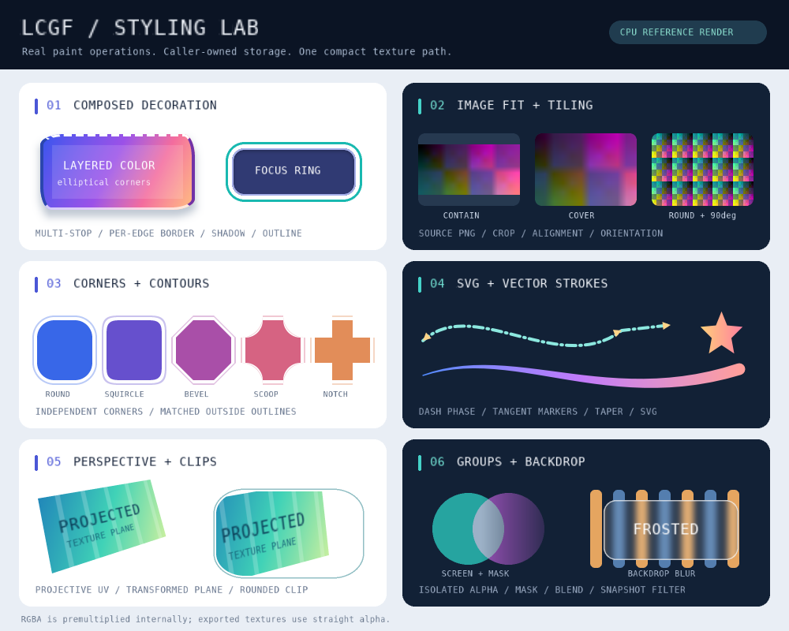

# Styling implementation guide

This branch implements the styling work packages from [the research plan](../research/styling/implementation-plan.md), using the existing LCGF layout, input and draw-list architecture. The research inventory is a map of capabilities and options, not a claim of CSS, SVG, a browser text engine or platform-wide HDR conformance. The [coverage record](coverage.md) maps every inventory ID to implementation, verification and the precise supported profile. The [validation report](validation.md) records what actually ran. [Restoration and publication instructions](handoff.md) accompany the source and Git bundle.



The gallery is generated by [ordinary Zig caller code](../../examples/styling/gallery.zig), using the repository's own font and PNG asset. It contains no screenshot mockups or generated artwork.

## Start with the operation your application needs

Three entry points coexist:

1. **Direct UI:** continue using `Style`, `TextStyle`, `Frame` and the existing widgets. Solid fills, compact quads, the normal layout sequence and explicit `Frame.finish` remain available.
2. **Optional styling and recipes:** `lcgf.style` resolves typed declarations, semantic tokens, variants, states and environment conditions into ordinary style/text values. `lcgf.theme_recipes` adds standard parts while preserving input behavior. A direct uncached resolver remains available alongside caller-owned caches and pools.
3. **Prepared paint:** compose brushes, borders, outlines, clips, vectors, masks or effects into caller-owned surfaces, export straight-alpha pixels, upload through the host's normal texture route, and bind the resulting texture to a node. The CPU preparation route works with the same compact image quad used by stock renderers.

The host chooses when each operation runs. There is no obligatory stylesheet manager, retained render graph, font registry, hidden allocator, event loop or renderer replacement in the core additions. Parsing/token generation, HarfBuzz and native shell integration are optional boundaries.

## Themes, states and component parts

`style.resolve` takes a `Request` with a base, optional parent, token table, scope, selected variants, combined states, environment, ordered rules and final local overrides. Resolution is per property. A hover rule that changes fill does not remove a keyboard-focus border, and two token roles that currently contain equal colors retain separate identities.

Absence is represented by no declaration. Explicit zero, transparent, inherited and initial values are distinct. A token alias is resolved through explicit scope data; missing references and cycles return errors. Pool IDs and cached inputs include caller-controlled generations. A theme change does not reconstruct token identity by comparing RGBA values.

Recipes expose root, content, label, icon, indicator, track, thumb, fill, tick, focus, placeholder, selection, caret and supporting parts, plus application-defined IDs. Standard runtime and compile-time consumers cover buttons, checkbox/radio/switch controls, sliders, progress, editable fields, navigation and data-view parts. Generic data rows and cells keep sorting, selection, tree expansion and application models with the caller.

The recipe field path paints selection foreground with disjoint clips over the original complete text. It preserves shaping context and avoids painting an antialiased glyph twice. A transparent or unchanged selection color has explicit behavior. Disabled and read-only controls retain their behavioral contract even if a local visual override requests an active appearance.

`style.inspector` reports the computed value, winning declaration, token origin, matched part/state, changed domains, capability decisions and bounded storage usage. `style.accessibility` checks known final paint samples and input bounds; complex backgrounds remain unknown until the host supplies samples. Diagnostics are data, not a certification.

The [recipe guide](recipes.md) gives concrete caller sequences, the adapter catalog, authoring formats and semantic-state rules.

## Layout and responsive presentation

The legacy `layout.finalize`, `Frame.end` and ordinary text completion preserve nearest whole-pixel rounding at scale one. The new `rounding.Options` selects `none`, `nearest`, `floor` or `ceil`, a positive device scale and a logical grid origin. Cumulative endpoints are rounded together; independently rounding widths would accumulate gaps or overlaps.

Use `Frame.endRounded` or `Frame.layoutRounded` for the common sequence. For custom passes, call `arrangeWith`, perform placement adjustments, call `finalizeLayout`, then `finish`. The text counterparts are `arrangeText`, `layoutTextRounded` and `endTextRounded`. `finalizeLayout` applies FLIP after the final placement, then derives snapped rects, world geometry, clips and visibility. This ordering lets RTL and custom layout agree with the previous frame's final arrangement. These frame calls round node/clip geometry. To snap text metrics too, run `rounding.text` after paragraph placement/bidi reorder and before glyph, decoration and caret emission.

Pure compile-time layout has `runRounded`, `runTextRounded`, `runLiveRounded` and `runLiveTextRounded`. A fixed viewport normally selects compact integer retained coordinates. Set `fractional_coordinates = true` when retaining fractional logical geometry; incompatible requests return `FractionalCoordinatesRequired` before mutating retained geometry. Resizable layouts already retain floating-point coordinates.

Optional measured modules provide intrinsic min/max/fit-content text sizes, relative units and bounded expressions, logical edges, extended flex distribution, wrapping/baselines, independent gaps, advanced grid/subgrid track contributions, dock/radial/flow/masonry placement, tables, columns and page fragmentation. These consume measured rows and produce ordinary geometry. Their native semantics and constraints are specified in the coverage record; they do not silently claim a CSS formatting algorithm.

`style.locale` supplies explicit direction, locale font preferences, translated labels, digit/group/decimal conventions and icon-mirroring policy. Runtime and compile-time convenience paths accept caller-owned RTL scratch and rounding options. Mirroring geometry preserves source reading order and keyboard order; the caller deliberately marks directional icons. Bidi text itemization is separate from mirroring the layout of controls.

The environment distinguishes unknown preferences from false. Viewport/container conditions, pointer precision, hover, density, safe area and keyboard occlusion are caller inputs. Layout-dependent conditions are resolved at declared measurement boundaries; there is no hidden iterative layout loop.

## Painting, images and vectors

The stock `Look` remains 32 bytes and `Quad` remains 136 bytes. Rich decoration data lives in borrowed descriptions, side tables and prepared surfaces.

| Area | Implemented operations |
|---|---|
| Color | RGBA8, HSL/HWB, Lab/LCH, OKLab/OKLCH, named SVG colors, gamut conversion and explicit interpolation/hue policy |
| Gradients | Arbitrary stops, coincident stops, transition hints, linear/radial/conic/sweep/two-circle geometry, pad/repeat/reflect, radial bound helpers |
| Backgrounds | Ordered layers, alpha, content/padding/border origin and clip, scroll/local/fixed positioning with explicit scroll/viewport data |
| Edges | Independent widths, brushes and patterns; inside/center/outside alignment; dashed/dotted/double and relief-style borders; separate outlines |
| Corners | Circular/elliptical/percentage/capsule radii and normalization; square/round/bevel/scoop/notch/superellipse contours |
| Images | Fit, stable destination boxes, crop, all eight orientations, tint/alpha, repeat/mirror/space/round, nine-slice, nearest/linear/mipmap sampling |
| Asset density | Source-size metadata, logical density, device-scale variant selection, decode-size hints and binding to the actual chosen image |
| Shadows | Ordered outer/inset analytic box shadows with contour-aware geometry; true alpha-derived content shadows through convolution |
| Vectors | Paths and arcs, fill rules, gradient/image fills, cap/join/dash/phase/markers, fixed-device strokes, tapering, TinyVG and a diagnosed static SVG subset |
| Clips and masks | Nested rectangle/rounded/path coverage, alpha/luminance masks, placement/tiling, inversion, add/subtract/intersect/exclude and nine-slice mask borders |

A background attachment describes a positioning space, not automatic window observation. The host supplies scroll offsets, scroll extents and viewport geometry. Image decode hints do not create an image loader or perform I/O; the selected loaded image is checked against the requested source/decoded size.

The SVG importer accepts a documented static asset/font profile. Unsupported constructs report errors. General SVG text layout, scripting, external resources and browser selector/layout behavior are outside that profile. Use native vector, mask and effect operations when composing those capabilities directly.

### Explicit render capability decisions

`capabilities.plan` returns direct/prepared routes and reports exact, approximate or unsupported support. A preparation-disabled or stripped renderer does not silently discard a requested effect. Analytic box shadows require explicit acceptance of their approximation; exact content-alpha convolution has a separate operation. Image-brush sampling is a preparation requirement because a stock backend's default sampler is not the brush's explicit sampling/LOD contract.

`capabilities.bake` checks the profile and budgets before rendering. `prepared.measure` reports dimensions before carving storage. `prepared.row` reserves the sparse paint-extra row while building; `prepared.bind` binds a texture after layout and before `Frame.finish`. Increment the resource revision when the same texture handle receives new pixels, so damage detects the resource change.

Surface scratch and export pixels must not alias borrowed image or coverage inputs. Rejections occur before clearing or exporting. Pixels in effect surfaces are premultiplied **encoded sRGB** RGBA8; ordinary texture uploads are exported as **straight** RGBA8. Linear-light interpolation and filtering are explicit choices. A premultiplied upload must not be fed to a shader that premultiplies it again.

## Groups, filters and projective paint

`prepared.drawRange` and the compositor expose completed-subtree semantics: render participating quads/text/custom images into a transparent surface, apply masks/filters, then composite the completed result once. Group opacity therefore differs correctly from multiplying each overlapping child by the group alpha. Explicit surfaces establish isolation and local ordering without adding a retained scene engine.

The `effects` helper evaluates a caller-provided backward-reference graph over caller-owned outputs and work surfaces. It includes compositing operators, artistic blends, color matrices, component transfer, independent-axis Gaussian blur, morphology, content shadows, displacement, convolution, arithmetic inputs, noise and lighting. It validates graph references, aliases, dimensions and surface/kernel budgets. The report includes full-surface pass count and retained transient bytes. Call primitives directly to reuse an intermediate whose lifetime has ended.

Backdrop capture is explicit and samples previous scene content. Its source region includes the filter halo; damage to that region invalidates an otherwise stationary panel. Draw later scene content after the backdrop result. CPU noise is a deterministic native noise profile, not a claim of bit-equivalence to SVG turbulence.

`projective` supplies 4×4 transforms, axis rotations, perspective/origin, projection/inverse mapping, backface handling and textured plane painting. The portable profile flattens planes in caller order. A retained preserve-3D scene with depth-aware hit testing is a separate host capability and is not inferred from the existence of a matrix type.

## Text, fonts and publication-oriented helpers

The native text stack supports font-backed measurement/native shaping, bidi/script analysis, cluster-aware fallback and editing, paragraph alignment, whitespace/tabs, spacing, truncation and caret/selection geometry. Arbitrary script/language-specific shaping is supplied by the optional HarfBuzz one-run adapter with caller-owned itemization. Rich paint spans reuse shared shaping when font/run properties agree. Cache keys include font identity/generation and shaping options; color-only edits can reuse shaping. Cache storage and invalidation inputs remain caller-owned.

The optional HarfBuzz adapter supplies extended shaping, variations, CFF/CFF2, palette/color-glyph paint, COLRv1 composition, raster color glyphs and plain/gzip OpenType-SVG through the declared SVG profile. Synthetic emboldening/slant is explicit: shaping calls reset complete variation and synthesis state, and PNG extraction restores temporary ppem. Low-level `outline` intentionally uses the currently configured font; independent atlas callers should use `outlineStyled` or explicitly set synthesis before outlining. Font-size adjustment is the native `font_match.applySizeAdjust` operation over real metrics, not an implicit HarfBuzz shaping option. Font-generation changes invalidate cached shaping. Native and HarfBuzz profiles remain distinct and testable.

Other public operations provide decorations and cluster-based emphasis marks, inline measured boxes, ruby, vertical orientation, source-to-display Unicode casing/full-width/password mappings, manual/pattern hyphenation, balanced wrapping, per-line widths for exclusions, drop caps, optical margins, text on paths and counters/list markers. `grid_names` lowers named lines/areas to real cells; `text_metrics` exposes first/last baselines and edge trim, and `Paragraph.baseline_source` is consumed by `Stack`. Balanced wrapping currently requires constant line widths; exclusion widths use the greedy profile, with incompatible requests reported as `UnsupportedPolicy`. Explicit trim/emphasis/ornament passes update `Lines`; use `text_metrics.commit` and apply the same policy consistently for measurement and emission. `Frame.endText` does not silently enable those optional passes. Mathematical layout consumes measured inline boxes and OpenType MATH constants/variants/assemblies, then emits ordinary text and rule geometry. It is a layout toolbox, not a TeX parser or symbolic-math engine.

Document layout is explicit: the caller owns items, page/column geometry, break opportunities and source mapping. The coverage record states which decisions are automatic and which are supplied by the caller. Unsupported combinations return an error instead of treating an unimplemented option as a successful paint operation.

## Input, semantics, scrolling and motion

`Participation` independently controls layout, paint, hit testing and semantic export, with inherited subtree restrictions. Hidden-with-space and collapsed are different policies. Capture/focus is cancelled when a control becomes ineligible. Visual transparency alone does not invent a semantic disabled state.

`hit_targets` adds optional caller-owned entries for padding, minimum dimensions, rounded/elliptical targets or arbitrary path fill rules. Retain these entries with the completed tree, query that tree before beginning the next frame, and pass the result to `Context.beginWithHit`. For simultaneous fingers or pens, query each contact position into a caller buffer and pass those rows, in contact order, to `Touches.stepWithHits`; capture remains associated with platform contact IDs when rows move. Transforms and ancestor clips are shared with paint geometry. Overlapping targets resolve by layer then row. Pure compile-time paint/events expose the corresponding policy route. Empty/absent rows are not revived by a minimum target size. Path padding is rejected because geometric dilation requires an explicitly chosen algorithm.

Cursor styling includes inherited cursor values, an explicit default reset, platform mappings and fallback reporting. Custom cursor images use an ordinary final texture quad plus explicit hotspot and old/new damage. The host hides the hardware cursor and retains pointer updates; the cursor does not become an input or accessibility node.

`scroll_area` combines two-axis geometry, wheel/keyboard/thumb/track/arrow behavior and semantic scrollbar parts. The policy module exposes gutter/overlay/RTL placement, nested reveal, scroll padding, content anchoring, chaining/overscroll, snap choices and fixed/sticky constraints. Applications choose momentum and smooth-scroll scheduling explicitly.

Motion includes spring/tween conveniences and explicit playback/track operations: curves, steps, sampled easing, delay/rate/direction/iterations/fill, pause/seek/cancel/finish, typed property invalidation, color interpolation, size/position FLIP, motion paths and compatible morphing. Reduced-motion and hidden-subtree decisions are inputs. Completion is returned as data.

Animation exhaustion never replaces an unrelated live control. Checked reservations report `NoSpace`; convenience calls select a settled result and expose `Output.status.anims`, `.tweens` or `.flips`. The status remains one byte. FLIP reserves both axes together. Low-level compatibility slot calls use an inert discard row outside the stepped rows on overflow; callers that need success/failure should use checked reservation.

## Platform materials and managed color boundaries

Windows supplies DWM backdrop/corner/chrome-color operations; macOS supplies a real `NSVisualEffectView` material wrapper. Reduced-transparency policy selects no native material or an opaque fallback. These calls are explicit native shell features, not aliases for a portable blur. The GDI software client remains opaque; making a DWM backdrop visible through client pixels requires a compatible host presentation path. The AppKit material surrounds the GPU view, and meaningful translucent regions require the host's chosen clear/background alpha. GPU text does not automatically acquire AppKit vibrancy.

`color_output` provides linear float planes in absolute luminance, sRGB/Display-P3/Rec.2020 primaries, explicit white level, PQ/HLG/linear transfer, HDR/SDR mixing, tone mapping, dithering and float/half/RGB10A2 outputs. Surface alias checks protect the conversion boundaries. Activating an HDR swapchain, discovering display headroom, applying ICC profiles and negotiating window-system color management remain host capabilities. The portable RGBA8 profile does not claim native HDR presentation.

## Costs, compatibility and reproduction

The runtime capacity slope is **1004 bytes per node**, compared with **924 bytes** at the upstream baseline. The additional 80 bytes cover two generations of sparse paint-extra capacity. `Look` remains 32 bytes, `Quad` 136 bytes; CPU text/custom rows are now 96 bytes to carry coherent transform/clip/opacity data. These CPU row layouts are an intentional source/ABI change for callers constructing them directly. Existing named-field initializers receive defaults; code serializing raw rows must update.

Hit-target entries, style caches, prepared surfaces, masks, graphs, extended typography and fractional compile-time coordinates are optional. The runtime capacity number is capacity accounting, not the average memory of only the visible controls. Offscreen pixels usually dominate rich effects; budget them independently.

Use the pinned Zig `0.18.0-dev.1151+8dfb7a7cc`:

```sh
zig build test harfbuzz wayland gles accesskit docs styling-check -Drender=sw -j2 --summary all
zig build styling-gallery -Drender=sw -Dgallery-output=docs/styling/gallery.png
zig build styling-bench -Drender=sw -- docs/styling/benchmark.json
python3 -m unittest discover -s tools/stylegen -p 'test_*.py'
python3 tools/styling/coverage.py --check
zig build fmt
```

The benchmark uses a full CPU redraw, 128 warm frames plus the first measured frame, and reports phase percentiles, draw commands, damage bounding-box area, context bytes and effect surface passes/storage. Its measured paths contain no allocation calls; this is a source contract, not an allocator-instrumentation result. Setup/export are outside them. It is a reproducible workload observation on the recorded host, not a comparison with the upstream commit or a general performance guarantee.

## API design rationale

The design follows the concrete caller-first and granularity principles studied in [the Casey Muratori API review](../research/styling/api-design.md): preserve independently callable operations under conveniences, keep authority with the caller, state retention/lifetimes, and avoid coupling an unusual decoration to an unrelated manager or renderer. The readable primary articles were studied; the report explicitly records that the complete lecture recordings were not accessible. The implementation does not claim endorsement or a verbatim transcription.
