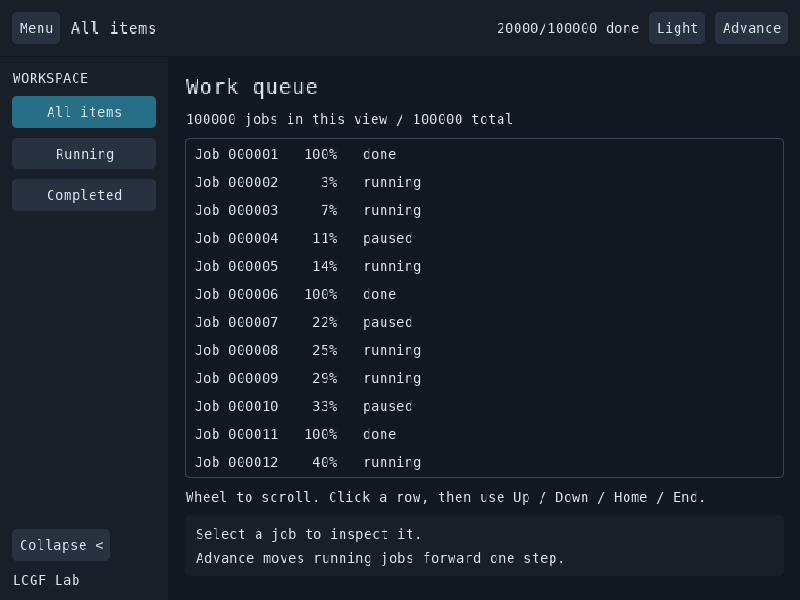

# Architecture lab

Five Zig application structures over the same LCGF workbench: **VIPER, MVP,
MVVP, MVVM, and MVVM-C**. The sidebar, top bar, and workspace are separate
features. All variants share the same domain operations, passive feature views,
cached projection, and virtualized 100,000-record workload.

The sidebar selects a filter. The top bar advances sample jobs, changes the
theme, and controls the sidebar. The workspace builds only the visible rows.
State and commands are ordinary values; large record passes use dense columns.

**MVVP means Model–View–ViewModel–Presenter in this example.** It is an explicit
project-defined hybrid: a presenter coordinates the domain model and a separate
presentation-state owner. Standard MVVM is included independently.



## Build and run

Use the repository's exact Zig pin, **`0.18.0-dev.1151+8dfb7a7cc`**. From the
framework root, `nix develop` provides its pinned development environment; then
change to `examples/architecture-lab`. Run the following commands here:

```sh
zig build install test -j2
zig build run -Doptimize=ReleaseFast
zig build run -Darchitecture=mvvm_c -Doptimize=ReleaseFast
```

`zig build` installs the headless `architecture-snapshot` executable on every
supported host. On Linux it also installs `architecture-lab`, the X11 window
application. XWayland can provide its display. Other hosts can use the headless
tools and tests; a native window requires another platform adapter.

```sh
zig build snapshot -- preview.ppm
zig build run -Dincremental=false -Doptimize=ReleaseFast
```

The default architecture is `viper`; incremental software drawing is enabled
when the selected framework exposes `host.Incremental`. The explicit
`-Dincremental=false` option uses unconditional full drawing. The full-frame
benchmark and snapshot always render complete frames, independently of the
desktop redraw option.

### Choose an architecture

| `-Darchitecture=` value | Ownership and command boundary |
|---|---|
| `viper` | Feature entities, interactors, presenters, views, and routers; the application owns composition and navigation. |
| `mvp` | One model aggregate, a stateless presenter, and a passive view. |
| `mvvp` | A ViewModel owns presentation state; a presenter coordinates domain work and navigation. |
| `mvvm` | A ViewModel owns presentation state, accepts view commands, and calls model use cases. |
| `mvvm_c` | A ViewModel handles local behavior and a coordinator owns navigation. |

These names describe organization. They do not imply a performance ranking.
[Choosing and extending an architecture](docs/ARCHITECTURES.md) follows one
action through each variant and gives a worked inspector-module example.
[Adding modules](docs/ADDING_MODULES.md) explains the original VIPER feature
split in more detail.

### Copy the example outside this repository

The manifest has one framework dependency:

```zig
.dependencies = .{ .lcgf = .{ .path = "../.." } },
```

It uses the containing checkout's actual sources and generated Unicode module.
No runtime source snapshot or replacement framework build adapter is included.
After copying this directory beside another matching LCGF checkout, select that
checkout once:

```sh
zig fetch --save=lcgf ../LCGF
zig build install test -j2
```

Use the relative path appropriate to the copied project. The framework's
consumer build exports the software module without configuring its root-only
SDK and competitor targets. Its pinned Unicode archive is needed on the first
uncached build; dependency hashes remain verified. For an in-tree build using
the repository's populated package directory:

```sh
zig build install test --pkg-dir ../../zig-pkg -j2
```

Implementation links to `../../../src` in the optimization guide refer to the
containing framework checkout. When the example is moved, consult the same
paths in the dependency selected by `zig fetch`.

## Tests and tools

| Command | Scope |
|---|---|
| `zig build test` | Application/domain/cross-architecture tests **and** the framework host's full-versus-retained differential tests. |
| `zig build host-test` | Only the software-host differential suite. |
| `zig build framework-test` | The selected dependency's complete core regression suite. |
| `zig build check` | Compile tests, the snapshot, and the supported native host; check example/tool Zig formatting. |
| `zig build fmt` | Check formatting without changing files. |
| `zig build x11-test` | Linux packet checks and any explicitly enabled live X11 tests. |
| `zig build snapshot -- preview.ppm` | Render the real application without a window server. |
| `zig build geometry` | Inspect geometry, glyph expansion, and shader eligibility without timing. |
| `zig build bench -Doptimize=ReleaseFast` | Measure UI preparation, complete software drawing, full CPU frames, and idle scheduling. |
| `zig build bench -Doptimize=ReleaseFast -- --architectures` | Compare all five architectures with warm and changed-filter projections. |
| `zig build core_bench -Doptimize=ReleaseFast` | Measure larger public frame/layout/text scenes. |
| `zig build incremental_bench -Doptimize=ReleaseFast -- 101 800 600 1` | Compare full and incremental drawing through changing frames; check every complete framebuffer. |
| `zig build reuse_bench -Doptimize=ReleaseFast` | Compare public subtree reuse with full rebuilding, including per-frame output and update counters. |

Live X11 tests require a dedicated usable server selected explicitly through
`LCGF_X11_TEST_DISPLAY`. They otherwise skip. `check` compiles artifacts; `test`
executes its suites. The repository's examples CI discovers this standalone
build and runs `install test`, including the host differential tests.

Use `-j2` on constrained machines and finish compilation before timing.
`-Dlanes=4`, `8`, or `16` can select a vector width for additional validation.
Forcing a wide vector on a narrower target checks correctness and compiler
splitting; it does not establish native throughput on a different ISA.

## Benchmark reproducibility

[BENCHMARKS.md](docs/BENCHMARKS.md) documents the exact timing boundaries,
before/after executable comparisons, dynamic scenarios, and interpretation of
valid reuse results. The example consumes one checkout at a time. Compare
separately built executables from identified revisions rather than selecting a
vendored `baseline` or `optimized` tree.

```sh
zig build bench-build incremental_bench-build reuse_bench-build \
  -Doptimize=ReleaseFast -Dcpu=x86_64 -j2
```

`-Drevision=COMMIT_SHA` records a source identifier in application benchmark
metadata. Its default is `working-tree`; it is a label supplied by the caller,
not a Git lookup or proof that the working tree is clean. The Python runners
also record binary hashes, commands, configuration, output checks, and all run
medians. Timing comparisons require matching compiler, CPU target, optimization
mode, scene, and sampling settings.

## Source map and extension rules

| Path | Responsibility |
|---|---|
| [app.zig](app.zig) | Compile-time architecture selection and application test root. |
| [src/app.zig](src/app.zig) | VIPER composition, module state, command dispatch, and navigation. |
| [src/architectures](src/architectures/) | Four alternative ownership arrangements and shared domain/composition code. |
| [src/modules](src/modules/) | Separate sidebar, top-bar, and workspace feature implementations. |
| [src/core](src/core/) | Typed navigation requests and bounded command buffers. |
| [src/config.zig](src/config.zig) | Explicit record, UI, text, and visible-row capacities. |
| [src/ui](src/ui/) | Theme, virtualized table, and shared interaction helpers. |
| [src/platform/x11.zig](src/platform/x11.zig) | Window events, persistent rendering storage, and presentation. |
| [src/architecture_tests.zig](src/architecture_tests.zig) | Shared real-input and domain comparisons across all five architectures. |
| [tools](tools/) | Snapshots, geometry inspection, benchmark executables, and measurement runners. |

Use columns for large scans, indices for projections, and stable IDs for
commands. Keep small feature preferences in ordinary structs. Views borrow one
committed projection and collect intent; the command phase commits changes and
wakes a follow-up frame when needed. A visual helper does not need five files
unless it owns meaningful independent behavior.

The retained renderer requires persistent, exclusively owned pixel, glyph, and
snapshot storage. External writes require `invalidate()`. New target storage,
dimensions, scale, format, or background trigger full rendering automatically.
Unsupported custom/image/effect content retains full rendering. Read the
[software optimization guide](docs/SOFTWARE_OPTIMIZATION_GUIDE.md) for complete
contracts and examples, and [THIRD_PARTY.md](THIRD_PARTY.md) for distribution
notices.
