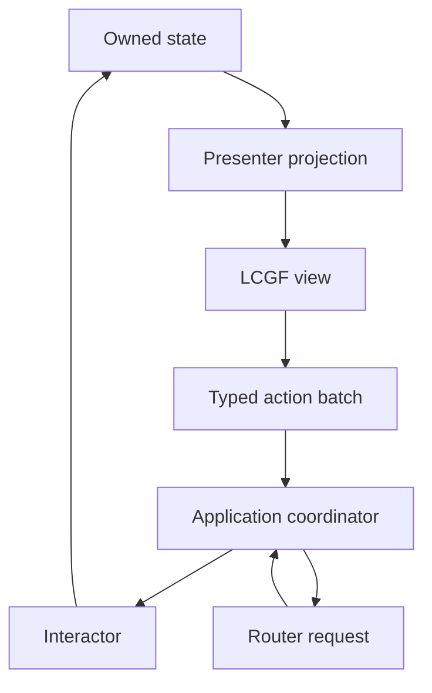

# Architecture and performance

The coordinator resolves simultaneous intentions: navigation takes precedence over a scroll action emitted by the previous page. Selection actions already carry stable entity IDs and remain valid. Public `dispatch*`, `commit`, and `route` functions mutate application state without platform work; an external caller must wake its host after a returned `true`. `App.build` does this automatically for actions emitted by views.

## Ownership comes first

`App` owns the current page and each module's state. A module receives only the data needed for its job. It does not retain an `App` pointer, reach into a sibling, or store an LCGF `Frame` in its entity.

| Lifetime | Owner | Examples |
|---|---|---|
| Application | `App` | Page, theme choice, collapse state, record columns, selection, filtered index cache. |
| Host/context | Host | LCGF context buffer, window, framebuffer, renderer resources. |
| One view pass | Stack/coordinator | Presenter models, command batches, formatting buffers, widget drafts. |
| One LCGF output | LCGF context backing storage | Tree rows, text spans, draw commands, geometry. |

The coordinator lends read-only state to every presenter/view in a pass. This is a consistent snapshot by ordering and const access; it does **not** copy the entire record store every frame. Presenter cache maintenance occurs before views are composed. State changes happen after all views have completed successfully.

## VIPER without an object graph



The presenter creates a view model. The view builds nodes and reports intent. The interactor mutates its module's state. The router translates actions requiring application coordination into a small shared request type.

All calls resolve through ordinary Zig imports and function calls. An empty router is an explicit extension seam; it does not need runtime registration or a polymorphic interface. If a component remains trivial, combining responsibilities in a small view helper is appropriate.

### Mutation boundary

Each view receives a fixed-capacity `Buffer(Action, 8)`. Appending can fail with `error.Full`. The coordinator finishes all view calls before applying their actions, so command overflow rejects every queued intent from that pass and shows an error banner. This boundary also makes input handling reproducible in tests. LCGF output-capacity failure is a separate host outcome; this command boundary is not a general rollback mechanism for arbitrary I/O or rendering errors.

LCGF widgets that accept a mutable pointer can still be used: make a local draft from the model, pass the draft to the widget, and emit an action when the draft changes. Do not pass the owned entity field directly if the interactor is supposed to enforce its invariant.

Payloads should be values and stable IDs. A pointer to a temporary formatting buffer is not an action payload with a useful lifetime. Large asynchronous payloads need an explicitly owned mailbox or handle.

### Follow-up frames

The view represents the state at the start of the pass. If a reduction changes state after the view is built, another frame must display that change. The coordinator calls `ctx.waker.post()` for an actual change.

This is intentional: at the pinned LCGF revision, `Frame.finish()` clears signal dirtiness, and scheduling decisions also depend on the wake flag. A state mutation at the end of `App.build()` must survive frame finalization. Merely updating an application field is insufficient.

For a future worker thread, also wake the host's blocking event wait. An atomic context flag does not itself interrupt an arbitrary OS event pump. Drain worker results and apply state changes on the owning thread.

## Record storage and projection

The demo's large data set has two dense columns:

```zig
progress: [capacity]u16, // 0 through 1000
active: [capacity]bool,
```

Only `0..len` is live. Advancing jobs streams through these columns, saturates progress at completion, and deactivates completed jobs. It changes the revision only when domain data actually changes.

This arrangement suits the sample's batch update. It does not imply that every value in an application belongs in a separate array. A sidebar's single `collapsed` flag and top bar's theme choice are clearer as small ordinary structs. Add or split columns according to the passes that read them.

The presenter cache stores storage indices selected for the current page. Its invalidation key is the domain revision plus the page. Pointer motion, selection changes, and scrolling do not require a new filter scan. Summary counts are computed in the same pass. Every filter preserves storage order, so mapping a selected stable ID to its visible position uses binary search. A domain update is still O(N), and rebuilding the filtered index map is still O(N). Virtualization makes **view construction** proportional to visible rows; it does not make every application operation O(1).

Each cache belongs to one store. If a new store replaces it, invalidate the cache even if the new store happens to have the same revision. If you add sorting, replace the binary-search mapping or maintain an appropriate reverse index: the current search relies on sorted storage indices.

The cached index array borrows no internal string buffers. Returned view models borrow the store and the valid prefix of the cache only for the current call. Labels are formatted for visible rows, then copied into LCGF's frame text storage.

## Identity and lifetimes

Three kinds of index have different meanings:

| Value | Meaning | Can it survive filtering? |
|---|---|---|
| `ItemId` | Domain identity, `slot + 1` in this append-only starter. | Yes. |
| Visible row index | Position in the current filtered projection. | No. |
| LCGF `Node` | Row in one generated UI tree. | No. |

Use stable `ItemId` values in actions and derive widget IDs from them. Resolve a selection back through the current projection when presenting it. Sorting and filtering must never reinterpret the old row number as a new entity.

The starter does not delete or recycle record slots. If you add deletion, choose an explicit identity scheme: monotonic IDs with a lookup map, or slot-plus-generation handles. A reused slot alone cannot distinguish an old selection from a new record.

LCGF's context contains slices into the buffer used to initialize it. Keep that storage at a stable address. Do not initialize a context inside a struct and return that struct by value with pointers still aimed at its former stack storage. Likewise, `Output`, its draw list, and tree geometry are borrowed; consume them before the next frame changes the backing storage.

## Reuse, bounds, and rendering

The scheduler suppresses unnecessary whole frames. The list limits node creation to visible rows. Together these remove the largest unnecessary UI work in this template.

Interactive subtrees are rebuilt when a frame is due. The pinned `Frame.reuse` implementation checks signals, pointer activity, and animation, but not every keyboard-focus case. Unconditionally memoizing a sidebar can skip button activation or freeze its focus indication. Treat reuse as an optimization requiring its own dependency and input contract.

Budgets are part of the architecture:

- Record count cannot exceed the store capacity.
- Command batches report overflow explicitly.
- LCGF node/text/string/depth capacity errors appear in `Output.status`.
- Host glyph and framebuffer storage have independent bounds.

A production host must check those outcomes and choose a policy such as a visible error, a controlled rebuild with larger buffers, or a recoverable failure. Increasing all capacities indiscriminately makes the memory cost less predictable.

## How to evaluate performance changes

Start with ReleaseSafe while developing, then compare ReleaseFast when appropriate. Keep compiler revision, target CPU, optimization mode, dataset, viewport, and measurement scope fixed.

Measure these separately:

1. Idle scheduling: no unexpected frames after settling.
2. Scrolling: visible row construction and layout with an unchanged projection.
3. Filtering: full projection rebuild and the next visible frame.
4. Advancing records: column pass, revision invalidation, and projection rebuild.
5. Rendering/presentation: pixel dimensions, backend, and display behavior.

Optimize the dominant pass. Consider more selective invalidation, incremental aggregates, another renderer, or worker-owned computations only when the measurement explains the need. Manual SIMD, padding, branch removal, and threading each add contracts; this starter leaves those choices local to the operation that benefits.
